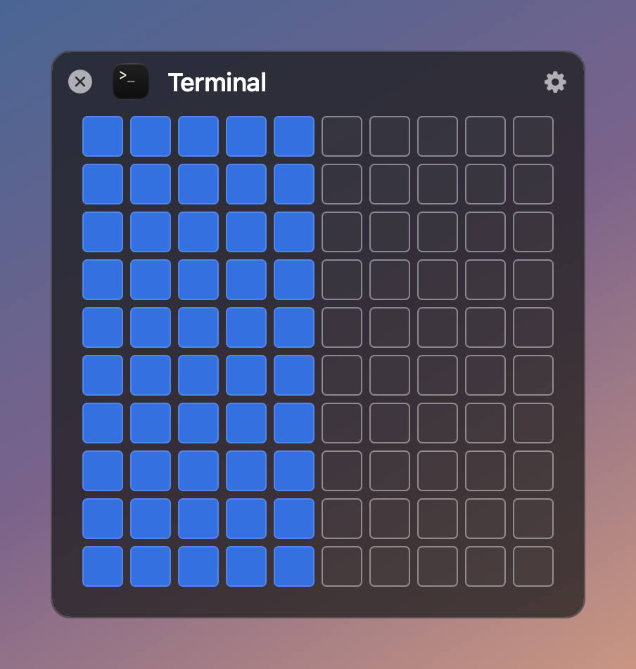
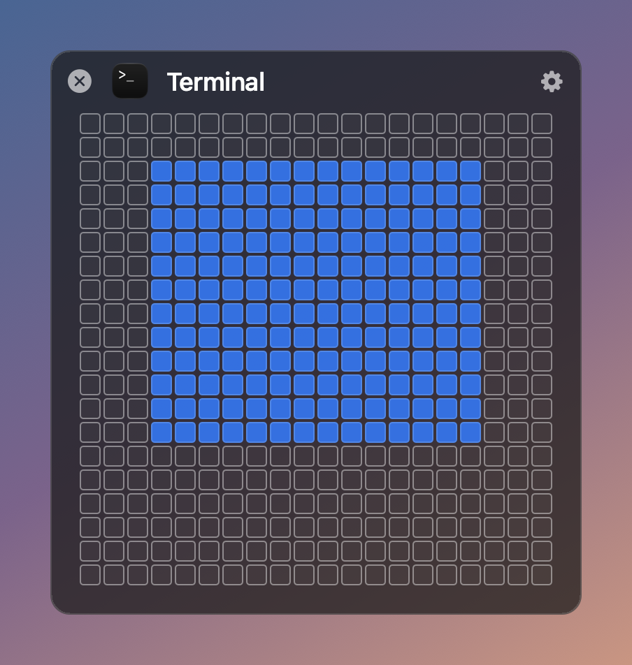
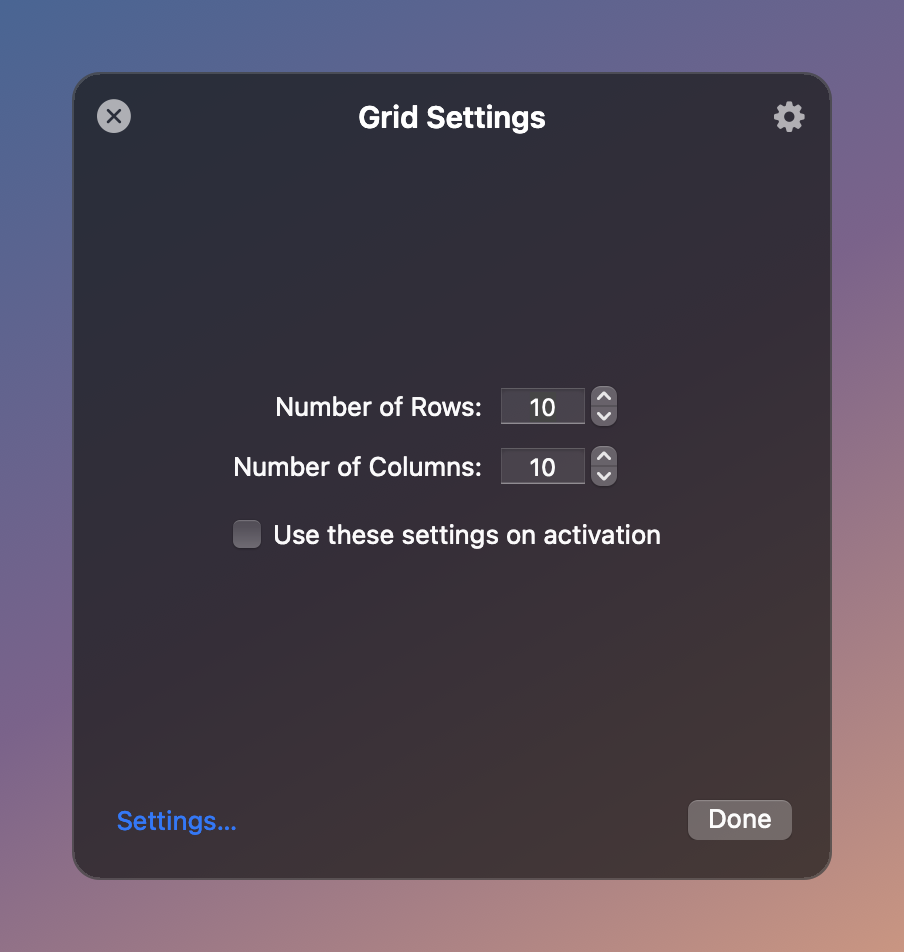
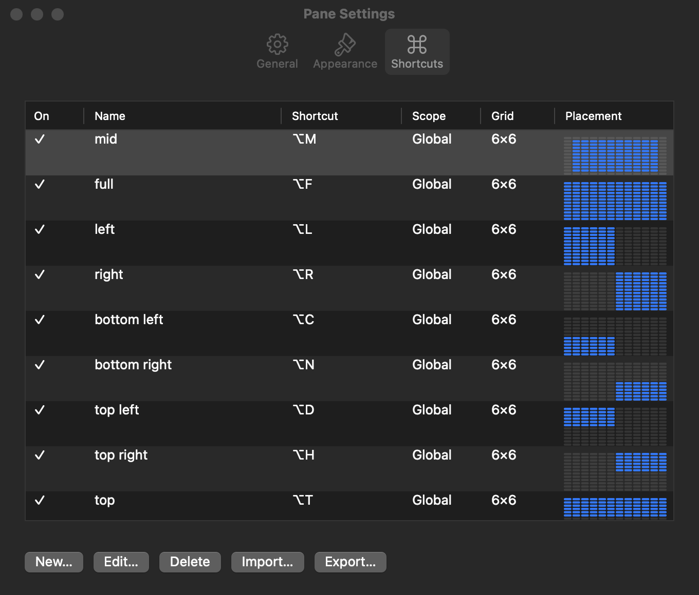
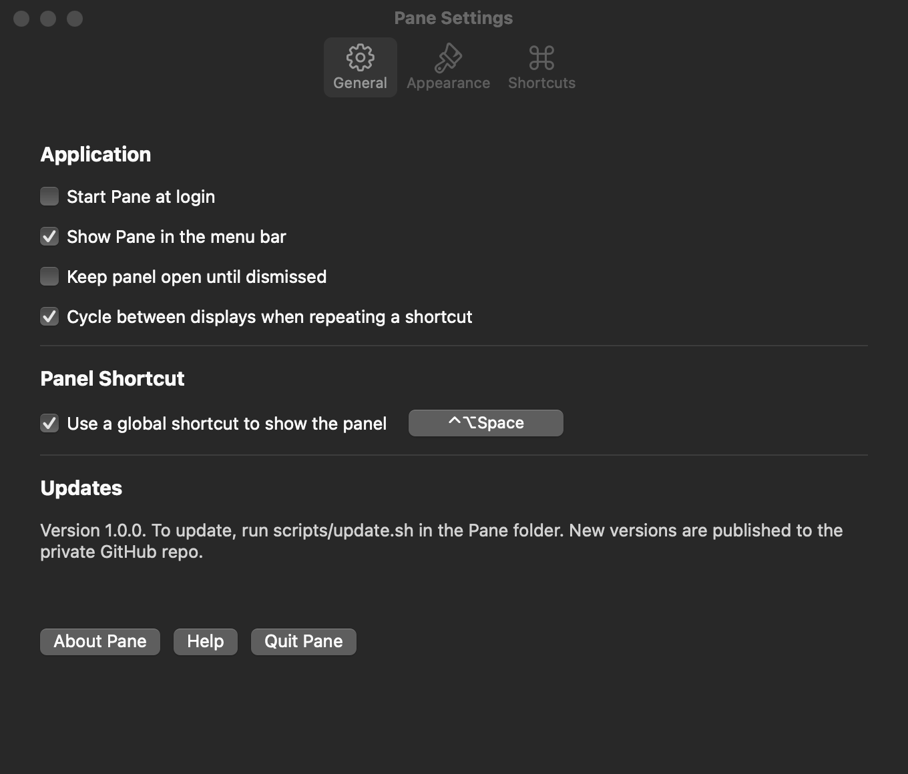
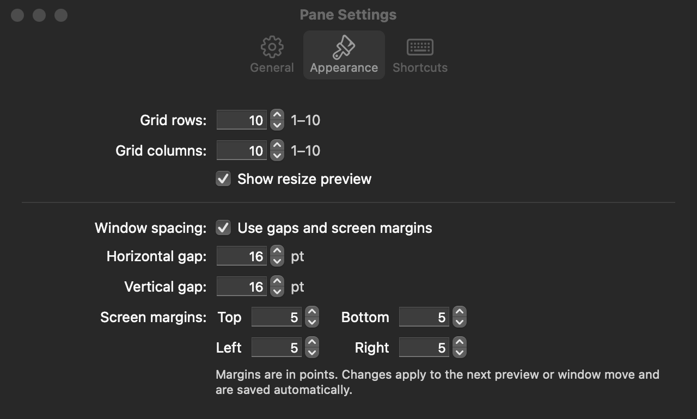
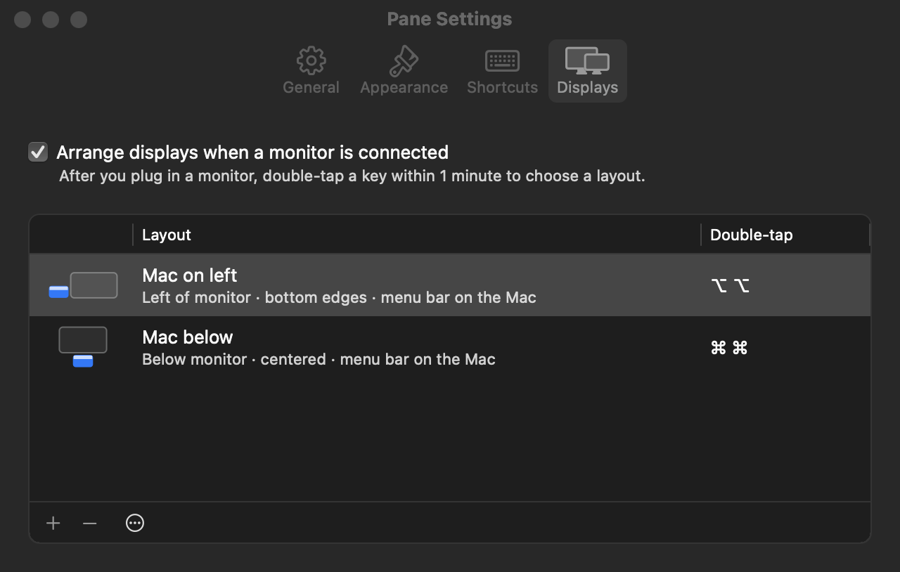

# Pane

Pane is a native Apple Silicon window manager for macOS 13+. Open the grid from the menu bar or a global shortcut, drag across cells, and the frontmost window snaps to that area. Save placements as global keyboard shortcuts. When you plug in a monitor, double-tap a key to arrange your displays.

## Screenshots

| The grid | Finer grid (press ⌥ Option) | Grid settings (gear) |
|---|---|---|
|  |  |  |

Drag across the cells and the window snaps there; a live preview shows where it will land. Press **Option** to switch to a grid twice as fine, and again to switch back. **Esc** closes the panel. **⌘ =** / **⌘ −** change rows; add **Shift** for columns.

| Shortcuts | General | Appearance |
|---|---|---|
|  |  |  |

Screenshots are rendered by the app itself: `build/Pane.app/Contents/MacOS/Pane --snapshot-overlay docs/screenshots` (the overlay renders show a flat backdrop because the live blur can't be captured offscreen).

## Display layouts

Move your Mac between spots without opening Display Settings. After you plug in a monitor, double-tap a key within **1 minute**:

| Double-tap | Layout |
|---|---|
| **⌥ Option** | **Mac on left**: Mac to the left of the monitor, bottom edges lined up |
| **⌘ Command** | **Mac below**: Mac under the monitor, centered |

A short message confirms the change. After the minute is up, double-taps do nothing until the next time a monitor is connected. Only the key on its own counts, so shortcuts like ⌘C never rearrange your displays. It works with any monitor.

Change the layouts, add your own (left, right, above or below; top, center or bottom alignment; menu bar on the Mac or the monitor; Option, Command, Control or Shift), or try one with **Apply Now** in **Settings → Displays**. To turn it off, uncheck **Arrange displays when a monitor is connected**.

From Terminal: `/Applications/Pane.app/Contents/MacOS/Pane --apply-layout "Mac below"`.



## Download and install

1. Download the latest **Pane-x.y.z.dmg** from [Releases](../../releases/latest).
2. Open the DMG and drag **Pane** onto **Applications**.
3. Open Pane from Applications. The first time, macOS may say it can't verify the developer: open **System Settings → Privacy & Security**, scroll down and click **Open Anyway** (or right-click Pane in Applications and choose **Open**). This is needed once, because Pane isn't notarized by Apple yet.
4. Turn on Pane in **System Settings → Privacy & Security → Accessibility** when asked, so it can move windows.

Requires a Mac with Apple silicon (M1 or later) and macOS 13 or later.

## Build from source

```sh
scripts/install.sh
```

This builds a release arm64 app, quits any running Pane, installs `/Applications/Pane.app`, and launches it. From an automated or sandboxed shell, use `scripts/install.sh --no-launch` and open Pane yourself: macOS checks Accessibility against whoever launched the app.

### First run: Accessibility permission

Pane moves other apps' windows, so macOS requires Accessibility access. When prompted, open **System Settings → Privacy & Security → Accessibility** and turn on Pane. The menu-bar icon's right-click menu shows the current status and has a recovery helper.

### One-time: signing certificate (recommended)

```sh
scripts/create-signing-cert.sh
```

macOS ties the Accessibility permission to the app's code signature. Without a stable signing identity each build is signed ad-hoc and looks like a new app, so you'd have to re-grant Accessibility after every update. This script creates a self-signed **Pane Local Signing** certificate in your login keychain (valid 10 years). `build-app.sh` uses it automatically when present. It's safe to re-run. Keychain Access lists the certificate as "not trusted"; that's expected and doesn't matter for local signing.

After the first signed install, grant Accessibility once more. From then on, updates keep it.

## Update

```sh
scripts/update.sh
```

Runs `git pull` and then `scripts/install.sh`. If you installed from a DMG, download the newest DMG from Releases and replace Pane in Applications.

## Release

1. Bump the version in `VERSION` (for example `1.1.0`) and commit.
2. Run `scripts/release.sh`.

The script refuses to run with uncommitted changes. It builds `build/Pane-<version>.dmg` and `build/Pane-<version>-arm64.zip`, tags `v<version>`, pushes the tag, and creates a GitHub release with generated notes. The build number (`CFBundleVersion`) is the git commit count.

To build without installing, run `scripts/build-app.sh`. It produces `build/Pane.app`, `build/Pane-<version>.dmg` and `build/Pane-<version>-arm64.zip`.

## Sharing shortcuts

Your shortcuts live only in your own preferences. They aren't built into the app, so a fresh install starts with no shortcuts.

- **Export:** Settings → Shortcuts → **Export…** saves a `My Pane Shortcuts.paneshortcuts` file you can send to someone.
- **Import:** Settings → Shortcuts → **Import…**, or just double-click a `.paneshortcuts` file in Finder. Pane asks whether to:
  - **Merge:** add the shortcuts to yours and skip ones you already have. If an imported shortcut uses keys that are already taken, it's added disabled, and Pane lists those shortcuts so you can give them new keys.
  - **Replace:** swap your whole list for the file's shortcuts.

A file that can't be read never changes your existing shortcuts. Older plain-JSON exports can still be imported.

## Development

```sh
swift build --arch arm64
DEVELOPER_DIR=/Applications/Xcode.app/Contents/Developer xcrun swift test --arch arm64
```

Tests use temporary `UserDefaults` suites and never touch your real shortcuts. `DEVELOPER_DIR` is needed only if `xcode-select` points at the Command Line Tools, which lack XCTest.

The internal bundle identifier is `com.karunpai.Pane` and the executable is `Pane`. Don't change either: your preferences and Accessibility permission are tied to them.

## License

Pane is released under the [MIT License](LICENSE). Copyright © 2026 Karun Pai.
